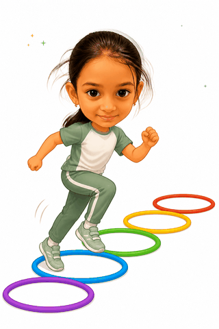

# Animated Student Caricature Agent

Turns a photo of each student into a hand-painted, big-head caricature in the style of
[`assets/style_reference.png`](assets/style_reference.png), then animates it.



## How the agent works

For every student it runs this loop:

1. **Read the photo (Claude).** Claude writes precise likeness notes: face shape, skin tone, hair,
   eyes, smile, earrings, glasses, and 2-4 kind exaggerations. They are saved to `likeness_notes.json`.
2. **Draw (OpenAI image model).** The student photo and the style reference go to the image model
   with a prompt built from those notes, plus the student's activity and outfit.
3. **Review and retry (Claude).** Claude compares the drawing with the photo and the style reference.
   It scores likeness and style from 1 to 10 and lists defects such as wrong hair colour, extra
   fingers, cropped feet or stray text. If the drawing doesn't pass, the agent redraws it with Claude's
   corrections, up to 3 attempts, and keeps the best one.
4. **Animate.**
   - `video`: an AI video loop made with Sora image-to-video (`caricature_video.mp4`).
   - `procedural`: a free, local bobble-head animation, made with no API calls
     (`caricature_bounce.gif` / `.mp4`). The head bobs and tilts, the upper body bounces and sparkles
     twinkle. Legs and props such as hoops or balls stay still, so nothing gets distorted.
   - `both` (the default) makes both. If the video step fails or your account has no access, the agent
     falls back to the bobble-head animation automatically.

## Setup

```bash
pip install -r requirements.txt
export ANTHROPIC_API_KEY=...   # Claude: photo analysis + quality review
export OPENAI_API_KEY=...      # image generation (+ Sora video, optional)
```

## Usage

One student:

```bash
python -m caricature_agent one photos/aanya.jpg --name "Aanya Sharma" \
    --activity "kicking a football" --outfit "navy school sports kit"
```

A whole class, from a CSV roster (see [`examples/roster.csv`](examples/roster.csv)):

```csv
name,photo,activity,outfit
Aanya Sharma,photos/aanya.jpg,mid-hop through a line of colourful hoops on the ground,
Rohan Das,photos/rohan.jpg,"dribbling a football, one foot raised mid-kick",navy-blue and white school sports kit
```

```bash
python -m caricature_agent batch examples/roster.csv --out output/ --workers 3
```

Or point it at a folder of photos. Each student's name is taken from the file name, and everyone gets
the default hoop-hopping scene and green sports kit from the reference:

```bash
python -m caricature_agent batch class_photos/
```

Animate a caricature you already have (needs no API keys):

```bash
python -m caricature_agent animate some_caricature.png
```

### Output

```
output/
  summary.csv                 # one row per student: files, scores, attempts, errors
  aanya-sharma/
    caricature.png            # final still (best attempt)
    caricature_video.mp4      # AI animation (if available)
    caricature_bounce.gif     # bobble-head loop, good for WhatsApp / slides / web
    caricature_bounce.mp4
    likeness_notes.json, prompt_attemptN.txt, review_attemptN.json, attemptN.png
```

## Configuration (environment variables)

| Variable | Default | Purpose |
|---|---|---|
| `CARICATURE_CLAUDE_MODEL` | `claude-opus-5-5` | analysis and review model |
| `CARICATURE_CLAUDE_EFFORT` | `high` | Claude effort level |
| `CARICATURE_IMAGE_MODEL` | `gpt-image-2` | image model |
| `CARICATURE_IMAGE_QUALITY` | `high` | `low` / `medium` for cheaper drafts |
| `CARICATURE_VIDEO_MODEL` | `sora-2` | `sora-2-pro` for higher quality |
| `CARICATURE_VIDEO_SECONDS` | `4` | 4, 8 or 12 |
| `CARICATURE_MAX_ATTEMPTS` | `3` | redraws per student |
| `CARICATURE_STYLE_REFERENCE` | `assets/style_reference.png` | swap in a different house style |

## Privacy and consent

The photos are of children. Get parental or school consent before you upload them, and remember
that photos are sent to Anthropic and OpenAI for processing. `.gitignore` keeps `examples/photos/`
and `output/` out of git. Don't commit student photos.

## Notes

- Some video models refuse input images that show real or realistic faces of minors. When that
  happens, the agent logs it and uses the bobble-head animation instead.
- Each run produces different results. To get a better drawing for a specific child, run them again,
  or give a more specific `--activity` or `--outfit`.
